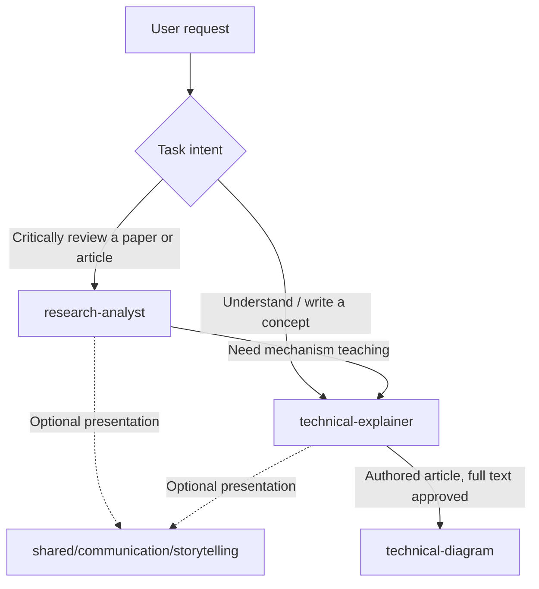

# AI Writing Skills — Skill Graph

从真实的研究、教学、技术写作与配图协作中提炼可复用的 Skills。**先根据任务目标选择能力，再在需要时沿依赖边调用下一项；不要让一个 Skill 承担互不相同的研究、教学、表达和作图职责。**

## Skill Graph



**Nodes (canonical entry points)**

| Node | Responsibility | Trigger |
|---|---|---|
| [`research-analyst`](skills/research-analyst/SKILL.md) | Source study, prior-art comparison, baseline and evidence auditing, independent judgment | “看看这篇论文新在哪里”“文章是否值得关注”“实验可靠么” |
| [`technical-explainer`](skills/technical-explainer/SKILL.md) | Teaching from reader questions, minimal examples, original educational writing and explanatory revisions | “为什么这样设计”“帮我写一篇 Transformer 科普”“这里我不理解” |
| [`shared/communication/storytelling`](shared/communication/storytelling.md) | Optional reader-oriented expression, narrative coherence, calibrated examples and metaphors | Referenced by research or teaching, **not** a standalone task Skill |
| [`technical-diagram`](skills/technical-diagram/SKILL.md) | Image briefs, technical diagram generation, audit, author acceptance and provenance | Only for actual figures after authored full-text confirmation |

**Key edges**

- **RESEARCH → TEACH:** The verdict and checked evidence remain unchanged while a difficult mechanism is re-explained.
- **TEACH / RESEARCH → COMMUNICATE:** Storytelling determines clarity and pacing **after** the owning Skill has established or appropriately qualified facts; not all outputs need a story.
- **TEACH → DIAGRAM:** For authored blog posts, the author must approve the complete text before generation or image editing; an article analysis does not initiate drawing.
- **REVISE:** If the issue is missing research evidence, route to RESEARCH; if the problem is a reader's understanding, route to TEACH.

## Why the separation matters

`technical-explainer` optimizes for **reader understanding**; `research-analyst` optimizes for **correct evaluation of external work**. They can run sequentially but should not silently replace each other. A well-structured story can still be misleading if a benchmark baseline is weak or prior art is ignored.

## Directory

```text
skills/
  research-analyst/
    SKILL.md
    references/research-review-checklist.md
    assets/analysis-outline.md
  technical-explainer/
    SKILL.md
    references/
      writing-checklist.md
      rnn-case-study.md
      tokenization-coauthoring-case.md
      story-driven-explanation.md   # backward-compatible pointer only
    assets/article-outline.md
  technical-diagram/
    SKILL.md
    references/acceptance-and-provenance.md
shared/
  communication/storytelling.md
evals/
  research-analyst.md
  technical-explainer.md
  technical-diagram.md
CHANGELOG.md
```

## Collaboration & validation

1. Read the canonical Skill for the request, plus only its relevant shared references and dependencies.
2. Before adding a rule, turn a real failure into a regression test in the owning Skill's `evals/` file.
3. Update the narrowest canonical rule, preserve historical case studies and avoid cross-Skill duplication.
4. Re-check the original failure plus a different-topic task. **Adding tests is not equivalent to passing tests.**
5. Document changes in [CHANGELOG.md](CHANGELOG.md) and verify that entrypoint links still resolve.

This repository follows the [Agent Skills specification](https://agentskills.io/specification). **Keeping files on GitHub does not automatically install or load them into every ChatGPT conversation.** A supported client needs to explicitly load the Skill, or a project instruction (e.g. `personal-blog/AGENTS.md`) should route the assistant to fetch the current canonical files.
